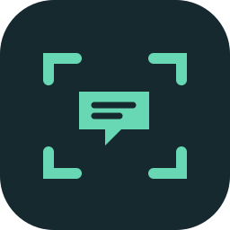
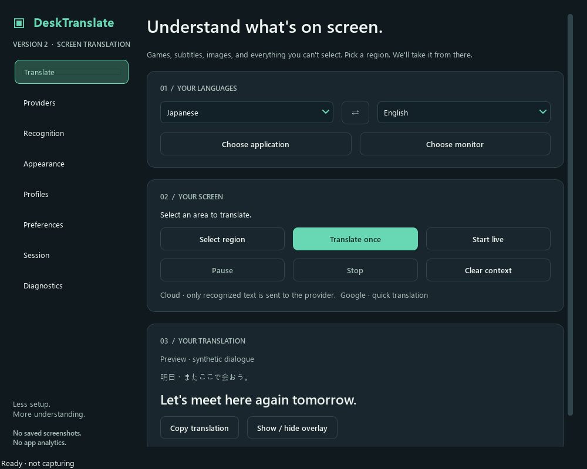
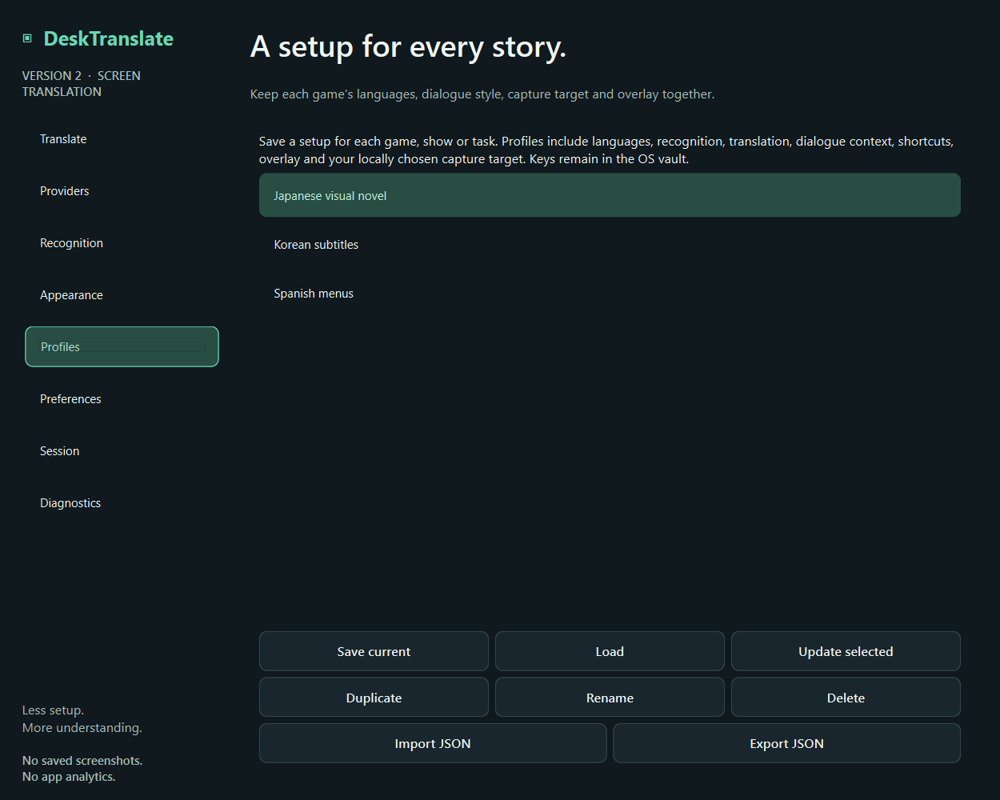
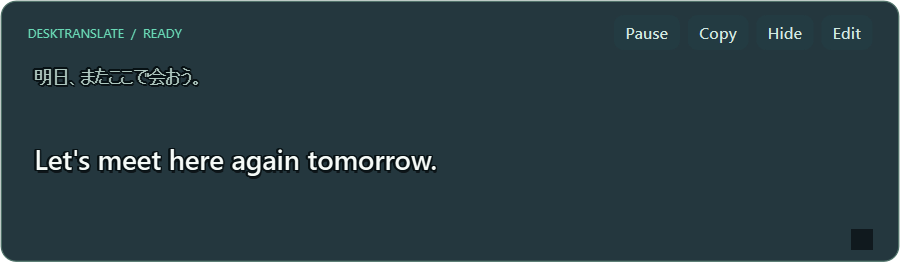
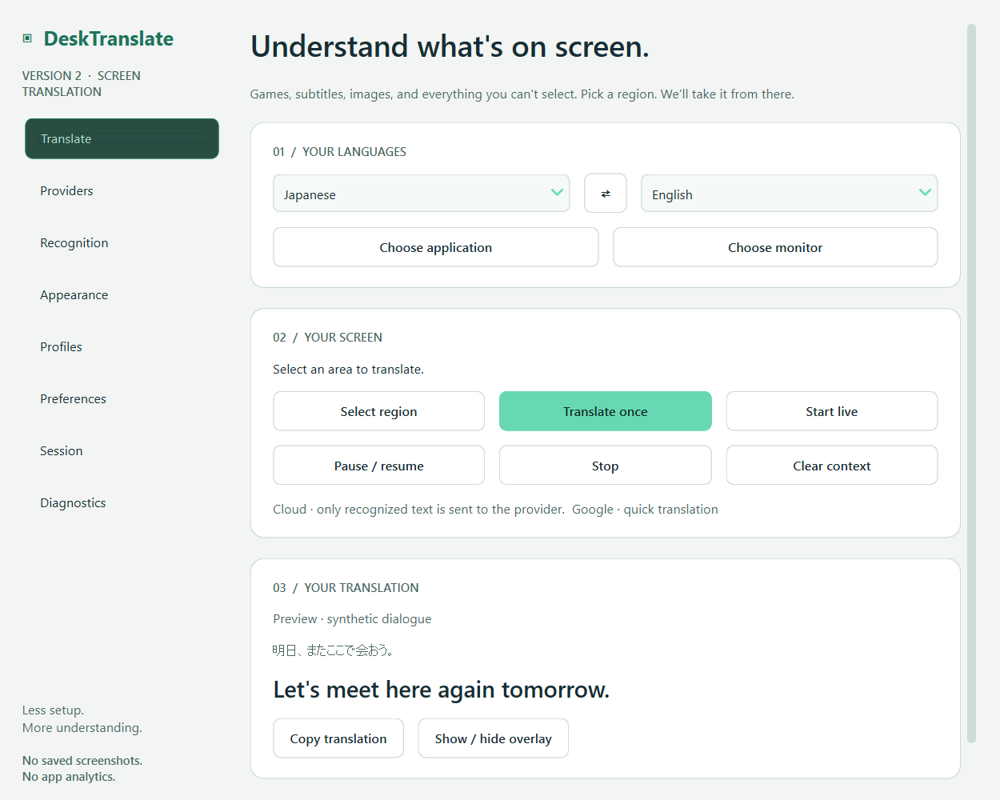

<p align="center"></p>

# DeskTranslate 2

**Understand what's on screen. Keep enjoying what's underneath.**

Translate the dialogue in a game, subtitles in a video, a menu, or text in an image. Press a shortcut, select a region, and read the translation in a quiet, customizable overlay.

[Release readiness](docs/release-readiness.md) · [Acceptance matrix](docs/validation.md) · [Non-invasive testing](docs/testing.md) · [Published releases](https://github.com/DeskTranslate/DeskTranslate/releases) · [Getting started](#your-first-translation) · [Upgrade guide](docs/upgrade.md)

**Version 2.0.0 is undergoing stable-release qualification. It has not been published as stable.** The new Windows application brings managed local OCR, contextual translation, application-following capture, profiles, guided setup, and an editable subtitle overlay. The final unpublished candidate uses version2.0.0; packaging and exact-source endurance gates remain pending. No new beta is planned. Publisher signing is unavailable; the approved release will disclose unsigned binaries. The release page currently contains the legacy application.



## A new foundation for screen translation

- **Choose once or stay live.** Snip a region for a single result, or watch a dialogue box for changes. Static frames skip OCR; obsolete requests cannot overwrite newer text.
- **Follow your application.** Bind a normalized subtitle region to a chosen window's client area. It follows movement and resizing, waits while covered or minimized, and reconnects after a restart only if you enable it. This uses visible-screen capture; keep the region unobstructed.
- **Recognition runs locally.** Managed, verified RapidOCR/ONNX models replace executable-path setup. Optional Tesseract remains available for existing installations. Japanese, Korean, Chinese, English and Spanish fixtures are included in the test corpus.
- **Choose how to translate.** Start with keyless quick translation, connect a conventional API, or use contextual AI locally or in the cloud. OCR and translation are independent choices.
- **Context for dialogue.** AI providers receive bounded recent lines, relevant approved terms and optional story notes. Save these with a title profile. Glossaries belong to a language pair; quick translation applies exact whole-term matches locally. Natural, literal, subtitle and game styles help preserve tone and terminology.
- **An overlay that fits your content.** Editable subtitle presets, typography, colors, gradients, outlines, shadows, line limits, source/translation layout, position locking and click-through. Enter edit mode with `Ctrl+Alt+E`.
- **A setup for every story.** Save, load, update, duplicate, rename and exchange profiles for games and shows. Profiles include language, OCR, provider/model, glossary, context, shortcuts and overlay settings. Keys stay in the OS vault; imported profiles require a new local capture selection.
- **A first translation you can see.** Guided setup installs the right recognition pack and processes an authored sample with actual OCR and your chosen provider. Back, retry and Set up later remain available.
- **Built for everyday use.** Searchable languages/models, global shortcuts, tray controls, light/dark and Windows high-contrast support, previewed diagnostics, and explicit stable/beta update checks. Runtime failures pause translation without opening the main window over your game.
- **Privacy you can understand.** Screenshots remain in memory. Cloud services receive recognized text and configured context, never screenshots. API keys use the OS credential vault. DeskTranslate has no app analytics and opts out of ONNX Runtime telemetry before inference. Local servers have their own logging policies. An optional bounded session transcript stays in memory until you explicitly copy or export it. [Privacy and dependency scope](docs/privacy.md).



Save a setup for each game, show or task, then load it when you're ready. The examples above are synthetic; keys stay in your local OS vault. [Read the privacy policy](docs/privacy.md) or [report a problem](https://github.com/DeskTranslate/DeskTranslate/issues/new/choose).

## Install

The planned stable distribution is **Windows x64**, primarily Windows 11. The installer's configured minimum is Windows 10 build19041; that setting does not establish current Microsoft support or successful runtime/hardware qualification. Once qualified artifacts are published, download the versioned `Setup-x64.exe` from this repository's release page. Installation is per user and needs no administrator account. Normal users need no Python, pip, Visual Studio, Tesseract, or manual DLL installation. See the [acceptance matrix](docs/validation.md).

For portable use, extract the **entire** ZIP into a writable folder and launch `DeskTranslate.exe`. Keep `_internal` and `portable-mode` beside it. Portable settings, logs, and downloaded models live in `DeskTranslateData` beside the executable; installed builds use `%LOCALAPPDATA%\DeskTranslate`. Credentials remain in your Windows account's vault. Move the entire folder to retain portable data.

Internal qualification binaries are **unsigned** and must not be treated as stable. Checksums detect changed files but do not establish publisher identity. Separate runtime/build SBOMs, a build provenance statement, library sources and third-party notices accompany new builds. No publisher certificate is available. The maintainer has approved an unsigned stable release once application qualification passes. Windows/SmartScreen may warn; no trusted publisher identity is claimed. Signing remains a future release improvement.

V1 did not persist language preferences. V2 starts with new settings and does not remove an unrelated legacy installation or Tesseract. Read [upgrade and data retention](docs/upgrade.md) before replacing an existing setup.

## Your first translation

1. Launch DeskTranslate and follow **Your first translation**. Choose your reading and translation languages; choose Japanese or Korean explicitly when reading those scripts.
2. Choose **Google · online · no API key** for simple setup, or use your configured provider. **Configure translation…** opens Providers; **Return to first translation setup** resumes your language choices and requires a new sample test. An existing local-provider choice stays selected when you reopen setup. Google uses a public web endpoint whose availability is not guaranteed.
3. Install the selected language pack and press **Translate sample**. Downloads show progress, support cancellation, and must pass SHA-256 verification. Setup is complete only after an actual successful sample or screen translation. You can reopen it in Preferences.
4. Press **Ctrl+Alt+T**, drag tightly around the text, and press **Enter**. **Escape** cancels. Resize a selection using its corners.
5. Read the overlay. For continuing dialogue, use **Ctrl+Alt+L** and select the dialogue area.

For a moving game or video window, choose **Choose application**, then **Region inside application** and select its subtitle area. Keep the area visible. A covered, minimized, missing or ambiguous target waits safely; it never falls back to another application's pixels. Fixed regions and entire-monitor one-shot capture remain available.

Use a tight text region for changing video backgrounds. DeskTranslate keeps the overlay outside that region to prevent it from translating itself. If a region leaves no space for an overlay, use a smaller region or one-shot mode; the result can appear in the main window.

The status at the bottom of every page tells you whether capture is running, paused or stopped. Pause becomes **Resume**; a failed request offers **Retry translation**. If a language pack is missing, review its size and choose **Install pack and start live** or **Install pack and translate once**. Downloads start only after that click. Stop, cancellation or a settings change cancels automatic continuation.

| Action | Default shortcut |
|---|---|
| Select and translate once | Ctrl+Alt+T |
| Select and start live | Ctrl+Alt+L |
| Pause / resume | Ctrl+Alt+P |
| Stop | Ctrl+Alt+S |
| Reselect region | Ctrl+Alt+R |
| Show / hide overlay | Ctrl+Alt+O |
| Copy latest translation | Ctrl+Alt+C |
| Edit overlay | Ctrl+Alt+E |

Shortcuts are configurable and checked for conflicts. First-run setup adds Shift (then Win if needed) when another app owns a default shortcut; the welcome screen shows your assigned shortcut. Closing exits by default; keeping the app in the tray is an explicit preference.

Launching DeskTranslate again restores its existing window. Separate portable folders remain independent. Quit hides the app while it finishes closing; setup cannot reopen or start new work during shutdown.

## Make the overlay yours



Choose Midnight mint, Anime subtitles, Cinematic, Paper & ink, or High contrast in **Appearance**, then customize. Font family, size, weight, italic, text/source colors, separate text/background opacity, gradient direction, outline, shadow, spacing, padding, corner radius and alignment are editable. Position it at the top or bottom center, drag/resize it, or reset the layout.

Click-through lets a game receive mouse input. Edit mode temporarily restores interaction and pauses an active session; finish editing and resume when ready. A reduced-motion option disables the brief appearance fade. Long translations shrink within a bounded range and clip at the configured line limit; **Copy** retains the complete text. The main window also contains the full result.



## Translation providers

Translation targets retain v1's 133-language catalog. OCR sources depend on the selected engine: managed source packs are listed separately from optional Tesseract languages. Provider language availability varies; a listed language does not promise universal OCR or translation accuracy.

| Provider | Processing | Setup |
|---|---|---|
| Google quick translation | Cloud, conventional MT | No key; public endpoint with no availability guarantee |
| DeepL | Cloud, conventional MT | Your API key; Free/Pro API endpoint as appropriate |
| LibreTranslate | Your local or HTTPS server | Endpoint; optional key; server languages vary |
| OpenAI | Cloud, contextual AI | API key; native Responses recommended, Chat Completions available |
| Anthropic Claude | Cloud, native Messages API | API key; discover/select a model |
| Google Gemini | Cloud, native generateContent | API key; discover/select a compatible model |
| OpenRouter | Cloud, contextual AI | API key; searchable catalog with available price/context metadata |
| Ollama | Local, contextual AI | Start Ollama and install a model yourself |
| LM Studio | Local, contextual AI | Load a model and start its local API server |
| OpenAI compatible | Local or remote | Loopback HTTP or remote HTTPS base URL; optional key |

API providers may charge usage fees. Trial credits or free quotas are not promised. In **Providers**, select a service, enter a key if required, and **Save and test connection**. Choose a discovered model and **Apply translation settings**. Official provider links are available in the app. Model names are not permanently hardcoded.

Advanced endpoint/API controls are hidden until requested. Known embedding, image, audio and realtime-only models are excluded from text-model lists; unknown compatible models remain selectable with unverified support. Native OpenAI requests disable response storage and streaming; compatible servers retain Chat Completions. [Provider setup and recovery](docs/provider-setup.md) explains privacy, costs and common errors. Glossaries support previewed JSON/CSV exchange; imported terms remain a draft until Apply.

**Find local AI servers** probes Ollama and LM Studio on localhost. DeskTranslate does not download large LLMs or silently fall back from local to cloud. Start/load the server yourself, test it, choose a model, and apply. Translation quality and speed depend on that model and your hardware.

## Release qualification

Core algorithms, concurrent stale-result rejection, settings recovery, ten provider request/response contracts, model integrity, UI flows and privacy boundaries have automated tests. Routine and pre-deployment checks run headlessly. Native desktop probes are separate, bounded manual checks for affected boundaries that cannot be verified below the UI; older reports qualify only their recorded scope/source. The installer and portable app are built with PyInstaller and Inno Setup.

The [validation report](docs/validation.md) distinguishes measured evidence from unqualified scenarios. The corpus now contains47 authored fixtures across19 managed source languages, including outlined, shadowed, translucent, low-contrast, vertical, mixed-layout and ruby text. The [regional Japanese check](docs/ocr-regional-qualification.json) reads all eight authored vertical layouts and the pixel-font line exactly, with18/20 positive cases exact overall; two punctuation/name cases and ambiguous-background false text remain. The eight layouts also [match across all three image treatments](docs/ocr-layout-preprocessing.json), including ruby after contrast/scaling. Warm regional calls on this host ranged from0.98–1.64seconds, with a1.20-second median across20 cases; rapid subtitles may outpace it. The first cold call took15.05seconds, including worker initialization. These small authored tests do not establish accuracy or throughput for every game or video.

## Current limits

- Regions stay within one monitor. Negative origins and mixed-scale coordinate transforms are tested; physical mixed-DPI, hot-plug and exclusive-fullscreen coverage still need a hardware matrix. Use windowed/borderless mode if capture is blank. Protected content cannot be promised.
- Auto recognition uses a Chinese/Latin family and is not universal. Choose the source script explicitly. Vietnamese accents, Chinese punctuation/Traditional characters and Japanese punctuation/name formatting retain fixture errors. Japanese columns use regional recognition with upright captions and conservative ruby handling; enable **Vertical columns** in Recognition. Paced authored moving/VN/subtitle/ruby/column workflows pass; this does not establish accuracy for every real game or film. Other managed languages retain experimental vertical ordering. A verified model download guarantees integrity, not recognition accuracy; reinstalling the same pack will not fix these errors.
- All adapters have contract/failure tests. Actual Ollama and LM Studio lifecycle tests have also run, but the tiny test model failed plain-text translation-quality checks. Paid-account APIs and a real LibreTranslate server remain unqualified. Choose and evaluate a model for your content; no universal accuracy or compatibility claim is made.
- The current implementation uses local CPU OCR and visible-window following. Cloud OCR, vision uploads, production GPU inference, universal automatic script routing, multiple simultaneous regions, speech and persistent history are not shipped. DirectML and Windows Graphics Capture remain documented investigations.
- macOS/Linux source portability is unqualified. The separate legacy [Mac project](https://github.com/DeskTranslate/DeskTranslate-Mac) is not the DeskTranslate 2 release.

## Develop and build

Use the hash-pinned **CPython 3.12.15 Windows x64** runtime prepared by `tools/install_python.ps1` for release builds. Application source accepts Python 3.12–3.14; other interpreters need their own release qualification.

```powershell
./tools/install_python.ps1
.tools/python-3.12.15/python/python.exe -m venv .venv
.\.venv\Scripts\python -m pip install --require-hashes -r requirements-bootstrap.lock
.\.venv\Scripts\python -m pip install --require-hashes --no-build-isolation -r requirements-windows.lock
.\.venv\Scripts\python -m pip install --no-deps --no-build-isolation -e .
.\.venv\Scripts\python -m desktranslate
```

```powershell
.\.venv\Scripts\python -m pytest -q --basetemp=.test-tmp
.\.venv\Scripts\python -m ruff check src tests tools
.\.venv\Scripts\python -m ruff format --check src tests tools
.\.venv\Scripts\python -m mypy src
.\.venv\Scripts\python -m desktranslate --smoke-test
.\.venv\Scripts\python -m pip_audit --require-hashes --disable-pip -r requirements-windows.lock
.\.venv\Scripts\python tools/library_sources.py
.\.venv\Scripts\python tools/build.py --installer --qualification
```

Install [Inno Setup 6](https://jrsoftware.org/isinfo.php) and put `ISCC` on PATH or set `ISCC_PATH` to its verified compiler. Build outputs are in `dist/`: portable ZIP, per-user installer, runtime/build SBOMs, provenance and checksums. Version metadata comes from `desktranslate.__version__`; a mismatched tag fails the build. [Signing and release qualification](docs/release-checklist.md), [CONTRIBUTING](CONTRIBUTING.md), [architecture](docs/architecture.md), [troubleshooting](docs/troubleshooting.md), and [the original audit](docs/audit.md) explain the workflow. See [SECURITY](SECURITY.md) for private vulnerability reporting.

## License

DeskTranslate 2 is licensed under [MIT](LICENSE). Third-party libraries and downloaded OCR models retain their own licenses. Qt/PySide6 license notices and replaceable shared libraries are included in binary distributions; see [third-party attribution](docs/third-party.md).
